# Harness Bench

Does the coding harness matter, or only the model? Harness Bench runs the same tasks with the same models through different agent harnesses (Codex, Pi, oh-my-pi, OpenCode, Hermes, Devin, Droid, DeepSeek Harness, and desktop apps run by hand; an adapter for Claude Code exists but was not part of the first pass) and reports pass rate, time, tokens and cost for each, with the statistics needed to tell a real difference from run-to-run noise.

> **Status (2026-10-08): a first pass has been run.** Ten harnesses, nine tasks, one run each (216 runs). Read the [first-pass report](https://waveorwaves.github.io/harness-bench/first-pass/) ([as Markdown](docs/first-pass/README.md)) with its limits before quoting any number: with one run per cell, no difference in pass rate is statistically clear. Repeats two and three of the plan have not been run.

## Key findings

- **The harness did not change whether the work got done.** With gpt-6.1-sol at medium effort, all ten harnesses passed all nine tasks: 90 of 90 runs.
- **It changed the bill.** The same nine tasks took 19 to 40 minutes, 0.64M to 4.15M tokens and $0.75 to $1.57 at list price. Pi was the cheapest and the Codex app the fastest.
- **The fastest harness was the one that could look at its own work.** The Codex app has a browser tool built in and made its 3D page in 6.7 minutes; the Codex CLI, same model and same maker, took 13.8. The app also ran outside the sandbox, so part of that gap is the setting.
- **The cheapest harness gave up nothing that was measured.** Pi cost the least on gpt-6.1-sol ($0.75), was the fastest of the eight run in the sandbox (23 minutes), and its ship never lost a pair. The saving is in context read again on every call: 0.45M cached input tokens, where the others sent 1.34M to 3.82M. On DeepSeek V4.1 Flash it was again the cheapest and the fastest of the four harnesses that passed all nine tasks.
- **Passing the checks was not the same as being finished.** Every 3D page that was judged passed the automatic checks. Judged blind, side by side, five of the ten never lost a pair and two lost eight of nine.
- **A cheaper model cost time on the hard task, not the easy ones.** On DeepSeek V4.1 Flash, through DeepSeek's API, the nine tasks cost less in every harness whose cost is fully known, about half for most (15% to 74% of the gpt-6.1-sol price), and the eight smaller tasks were as fast. But the 3D page took 15 to 60 minutes instead of 7 to 19. Two harnesses were still editing it when stopped at an hour.
- **One run each.** Every figure is a single run per harness, model and task. No difference in pass rate is statistically clear, and time and cost can move on a second attempt.

## Results at a glance

One row per harness, best first: tasks passed, then time. The bar is the share of the nine tasks passed, and the thin line across it is the 95% interval for that share, which is wide with nine runs. Time is for all nine tasks. Cost is tokens at one list price for every harness, an estimate and not a bill. The last column is the 3D task's blind judging: pairs won, tied and lost. Small numbers point to the notes under each board.

### gpt-6.1-sol, medium effort

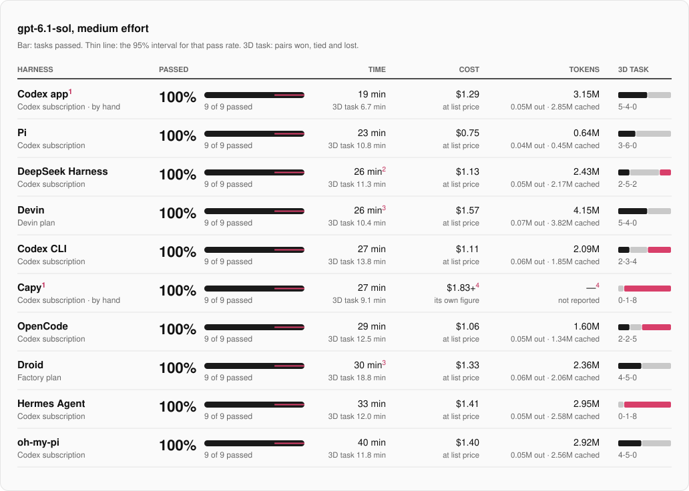

1. Run by hand in its desktop app on a Mac with a GPU, not in the sandbox. Compare its time with the other hand-run app, not with the command-line harnesses.
2. Timed to its final answer. Its command line then stayed open, idle, about five minutes before exiting; that wait is not counted.
3. The 3D task is a second attempt. The first was cut off at an earlier 15-minute limit while still working, and its tokens are not counted.
4. Capy reports dollars, not tokens. This is its own figure, with one task's share worked out from its usage total, so the true cost is this or a little more.

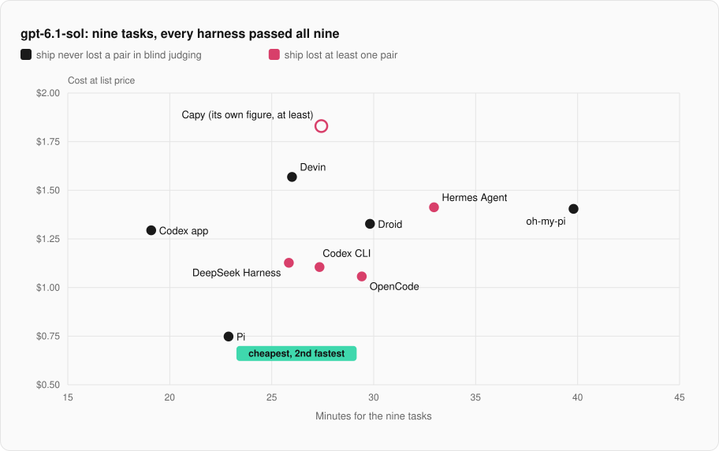

### DeepSeek V4.1 Flash, high effort

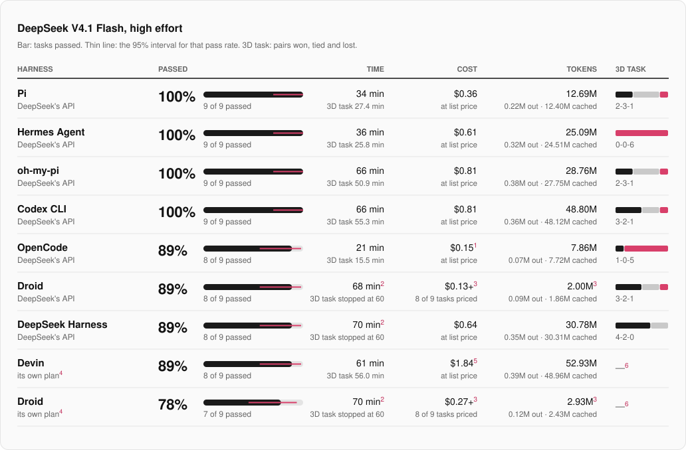

1. By far the shortest run on this model: OpenCode's 3D page took 15.5 minutes where the others took 26 to 60, so it used far fewer tokens than the other complete runs. That page was judged 6th of 7, and the run passed 8 of 9 tasks.
2. Still working on the 3D task when stopped at 60 minutes. The page it left passes every automatic check, but the run counts as not passed.
3. Droid reports usage only when a run ends, so its stopped 3D run has no tokens. Cost and tokens cover the other eight tasks.
4. The model as hosted by the harness's own plan. It is priced here at DeepSeek's API list price for comparison; on the plan it costs allowance, not dollars. Whether the plan serves the model with the same settings as the API is not visible.
5. Most of this is the 3D run, which sent 3.0M uncached input tokens.
6. Judged separately, as a single pair: Droid's page was picked over Devin's.

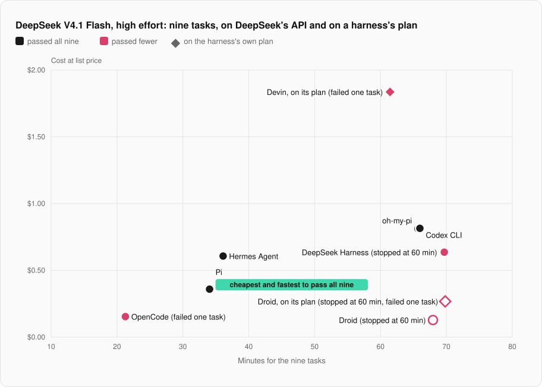

Seven runs on DeepSeek's API and, as diamonds, the two on a harness's own plan. These did not all finish the same work, so the lowest point is not the best one: OpenCode is cheapest and quickest because its 3D run was short, and it passed eight of nine. The two runs stopped at 60 minutes would have taken and cost more had they finished. A hollow point is a cost known only in part. The diamonds are priced at the same list price so they can be compared, but on a plan that cost is allowance and not dollars, and the plan may not serve the model with the same settings.

## The 3D task, judged blind

One task has no single right answer: a real-time 3D pirate ship at sunset, in one HTML file. Every page that was judged passed the ten automatic checks, so one person compared them side by side, 67 pairs in all, without knowing which harness made which. The rule was completeness first (gaps in the ship that the sea shows through), then a little weight for style.

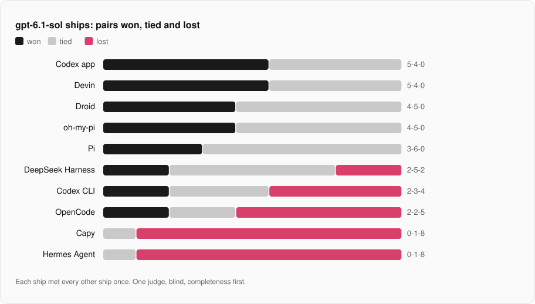

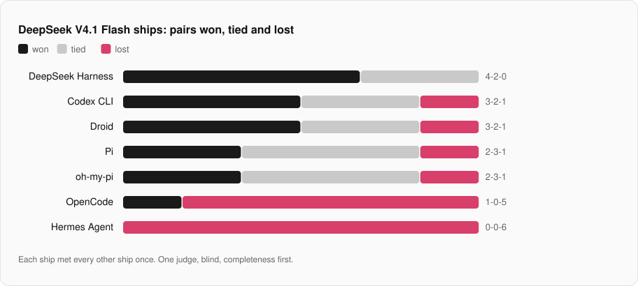

| | | |
|---|---|---|
| [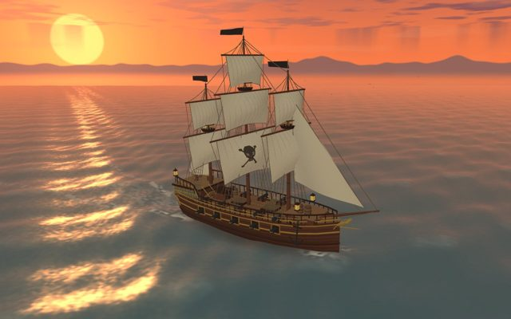](https://waveorwaves.github.io/harness-bench/first-pass/ships/gpt-6-1-sol.codex-app.html) Codex app · gpt-6.1-sol |  Devin · gpt-6.1-sol | [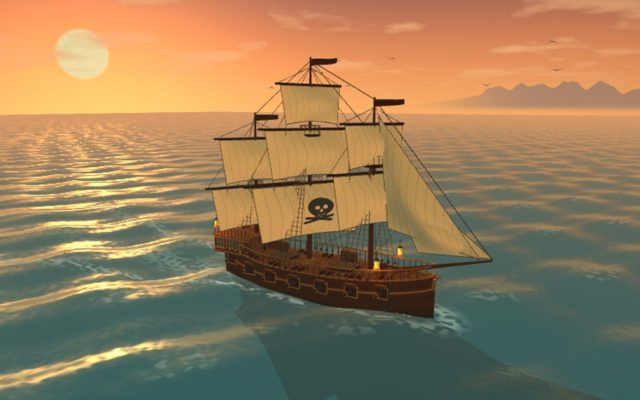](https://waveorwaves.github.io/harness-bench/first-pass/ships/gpt-6-1-sol.droid.html) Droid · gpt-6.1-sol |
| [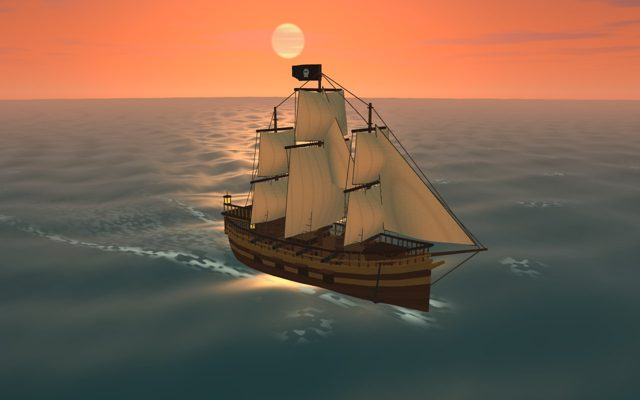](https://waveorwaves.github.io/harness-bench/first-pass/ships/gpt-6-1-sol.omp.html) oh-my-pi · gpt-6.1-sol | [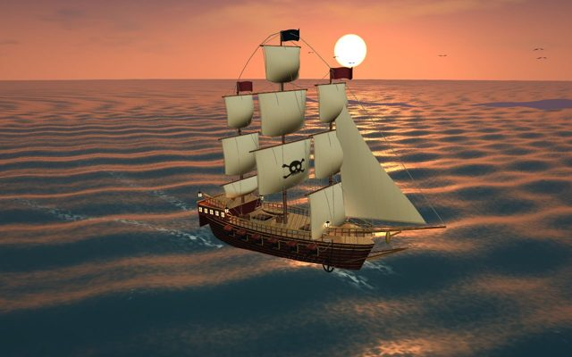](https://waveorwaves.github.io/harness-bench/first-pass/ships/gpt-6-1-sol.pi.html) Pi · gpt-6.1-sol | [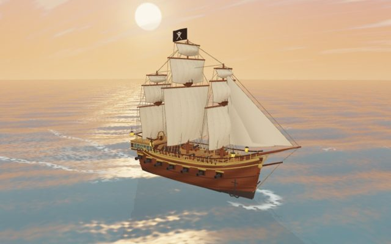](https://waveorwaves.github.io/harness-bench/first-pass/ships/gpt-6-1-sol.deepseek-harness.html) DeepSeek Harness · gpt-6.1-sol |
| [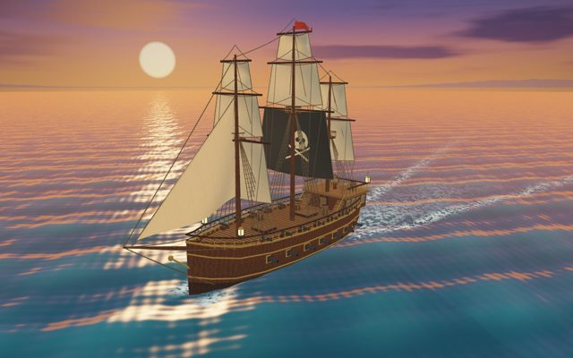](https://waveorwaves.github.io/harness-bench/first-pass/ships/gpt-6-1-sol.codex.html) Codex CLI · gpt-6.1-sol | [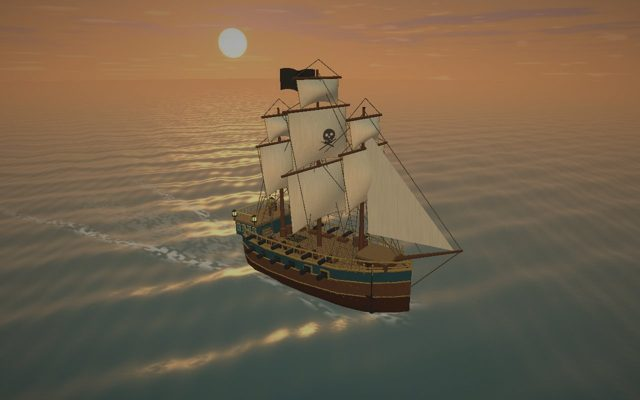](https://waveorwaves.github.io/harness-bench/first-pass/ships/gpt-6-1-sol.opencode.html) OpenCode · gpt-6.1-sol | [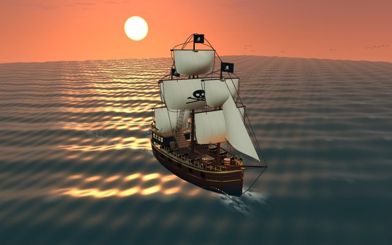](https://waveorwaves.github.io/harness-bench/first-pass/ships/gpt-6-1-sol.capy.html) Capy · gpt-6.1-sol |
| [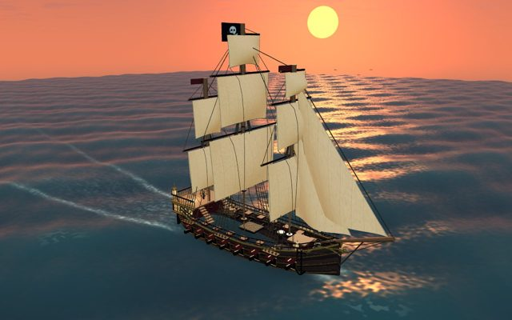](https://waveorwaves.github.io/harness-bench/first-pass/ships/gpt-6-1-sol.hermes.html) Hermes Agent · gpt-6.1-sol |  |  |

The ten gpt-6.1-sol pages, best-judged first. Each picture opens the page itself: drag to move the camera. [All 23 pages](https://waveorwaves.github.io/harness-bench/first-pass/ships/index.html), the DeepSeek V4.1 Flash ones included.

## Before quoting a number

- **One run per harness, model and task.** The plan has three repeats and one was run, so nothing here measures run-to-run variation.
- **Two settings.** The Codex app and Capy ran by hand on a Mac with a GPU. The other eight ran headless in a container without one. Compare times within a group.
- **Cost is an estimate** from tokens and one price list, not what anyone was billed. Runs on a subscription cost allowance, not dollars.
- **One judge** for the 3D task, and one page per harness and model.
- **Not in this pass:** Claude Code, Cursor and others; repeats two and three of the plan; any mode with subagents.
- **Made with an AI assistant.** The tasks, the benchmark and this write-up were produced with Claude Code, which is not among the harnesses compared.

The [full list of limits](docs/first-pass/README.md#what-this-does-not-show) is in the report. To explore: [interactive results](https://waveorwaves.github.io/harness-bench/first-pass/results/index.html) · [every ship, running](https://waveorwaves.github.io/harness-bench/first-pass/ships/index.html) · [data](https://github.com/Waveorwaves/harness-bench/tree/main/docs/first-pass/data).

**[Open the full report](https://waveorwaves.github.io/harness-bench/first-pass/)** for the setup, per-task figures, token breakdowns, every failed check, the judging tables and all the limits. It is also there [as Markdown](docs/first-pass/README.md).

## About this benchmark

Harness Bench runs the same tasks with the same model through different coding harnesses and measures what changes.

- **Same model, same task, same limits.** Only the harness changes.
- **Hidden checks.** Each task is graded by tests the agent never sees, on behaviour the prompt states.
- **A sandbox for every run.** Command-line harnesses run in a fresh container. Desktop apps are run by hand and labelled as such.
- **One price list.** Cost is tokens at the same prices for every harness, so the figures compare.
- **Eyes where tests run out.** The open-ended 3D task is judged blind, side by side.

Where to go next:

- **The results:** the [first-pass report](https://waveorwaves.github.io/harness-bench/first-pass/) ([as Markdown](docs/first-pass/README.md)) and its [data](docs/first-pass/data).
- **Running it yourself:** [how it works and how to run it](docs/guide.md), with the commands, keys and sign-ins, and the suite and task formats.
- **The method:** [methodology](docs/methodology.md), [the tasks](docs/tasks.md), the [visual track](docs/visual-track.md) and [how results should be written up](docs/writing-up-results.md).
- **Extending it:** [adding a harness](docs/adding-a-harness.md), the [protocol](docs/protocol.md) and the [result records](docs/results.md).

Related work this builds on in spirit: SWE-bench (hidden tests on real repositories), Terminal-Bench (harness-by-model leaderboards) and Aider's polyglot benchmark. Harness Bench is much smaller and aims at a narrower question: for one person's budget, which harness gives the most passes per dollar with a given model, and is the gap real.
